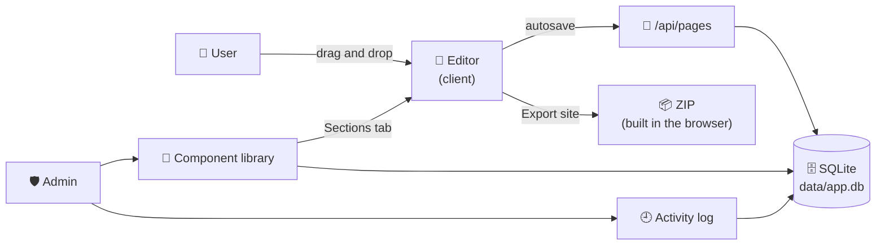

<div align="center">

# 🚀 ShinSpace

### Drag-and-drop page builder · Next.js 16 + Tailwind CSS 4 · Accounts, admin & export

*Build pages visually, edit the HTML if you want to, and download a clean static site as a `.zip`.*


[✨ Features](#-features) ·
[⚡ Quick start](#-quick-start) ·
[🧭 User guide](#-user-guide) ·
[👑 Admin guide](#-admin-guide) ·
[📦 Export](#-export-your-site) ·
[🧱 Architecture](#-architecture) ·
[🔌 API](#-api-reference) ·
[🩺 Troubleshooting](#-troubleshooting)

</div>

---

## 📖 Table of contents

- [✨ Features](#-features)
- [⚡ Quick start](#-quick-start)
- [🧭 User guide](#-user-guide)
- [👑 Admin guide](#-admin-guide)
- [📦 Export your site](#-export-your-site)
- [🎹 Keyboard shortcuts](#-keyboard-shortcuts)
- [📱 Mobile & responsive](#-mobile--responsive)
- [🧱 Architecture](#-architecture)
- [💾 Data model](#-data-model)
- [🔌 API reference](#-api-reference)
- [🔐 Security notes](#-security-notes)
- [🔧 Configuration](#-configuration)
- [💻 Development](#-development)
- [🩺 Troubleshooting](#-troubleshooting)
- [❓ FAQ](#-faq)
- [🚧 Roadmap](#-roadmap)
- [🙌 Credits & license](#-credits--license)

---

## ✨ Features

| | Area | What you get |
|---|---|---|
| 🧩 | **Visual builder** | Drag blocks onto a live canvas, or click to add. 20 block types, nested layouts, 100-step undo/redo, a Layers tree, and inline text editing. |
| 🎛️ | **Inspector** | A right-hand settings panel for the selected block: content, spacing box, colours, visibility per screen size, anchor, CSS classes and inline style. |
| 🌬️ | **Full Tailwind panel** | Every Tailwind utility on every block, per breakpoint (`sm` … `2xl`) and state (`hover`, `focus`). |
| 🎨 | **Colour pickers** | Preset swatches **plus** a custom picker pop-up: colour area, hue, opacity, hex, eyedropper and recent colours. |
| 📚 | **40 section templates** | Heroes, content, FAQ, pricing, stats, testimonials, social blocks, and **25 news/feed layouts** (grid, list, slider, stories, shop, overlay, native ads, paging…). |
| 📰 | **Feed settings** | Toggle overlay, subtitle, date, item count and a **native ad** (position + label) on every feed. |
| 🌐 | **Multi-page sites** | A site has a Home page and as many extra pages as you need (page switcher with add, duplicate, rename, delete). |
| 👀 | **Preview mode** | Wix-style breakpoints, device presets, custom width/height and portrait/landscape. |
| 📦 | **ZIP export** | Clean static site: `index.html`, `pages/`, one compiled `assets/css/style.css`, images extracted from data URIs. Empty folders are left out. |
| 👤 | **Accounts** | Register/login with a real SQLite database, per-account pages, profile page (name, email, password, devices, delete account). |
| 🛡️ | **Admin area** | Overview charts, users & roles, **component library** (every section is editable), and an **activity log** of what every user did. |
| 🧑‍💻 | **Code editor** | A CodePen-style editor (HTML/CSS/JS, live preview, responsive device switcher, resizable panes) for custom components. |
| 📱 | **Mobile friendly** | Editor panels become a drawer and a bottom sheet on phones; every built-in section is audited at 375px and 320px. |

<details>
<summary><b>🧩 The 20 basic blocks (click to expand)</b></summary>

| Layout | Basic | Media | Rich |
|---|---|---|---|
| Container, Full width, Row, Column | Heading, Text, Quote | Image, Video, Icon | Card, Accordion |
| 1 / 2 / 3 / 4 / 6 columns | List, Button | Embed, Map | Table, HTML |
| 2/3 + 1/3, 1/3 + 2/3, 1/4 + 1/2 + 1/4 | Separator, Spacer | | Box |

</details>

<details>
<summary><b>📚 The 7 section categories (click to expand)</b></summary>

| Category | Examples |
|---|---|
| 🦸 **Hero** | Hero with image, Centered hero |
| 📝 **Content** | Features, Image and text, FAQ |
| 📰 **Feeds** | Grid (2/3/4 columns, square photos), Overlay grid, Hero overlay + list, List, Compact list, Sliders, Stories, Shop grid/slider |
| 🧪 **Feed options** | Image label + type icons, Logo + kicker chip, Tag + title line, Author, Rating, Native ad, Numbered paging, Header variants |
| 💬 **Social feeds** | Post feed, Photo grid, Stories row, Activity timeline, Comment thread, Changelog |
| 🏆 **Trust** | Stats, Testimonials |
| 🎯 **Conversion** | Pricing, Call to action |

</details>

---

## ⚡ Quick start

### ✅ Requirements

| Tool | Version | Why |
|---|---|---|
| 🟢 Node.js | **22.5 or newer** (tested on 22.22) | The database uses Node's built-in `node:sqlite`, so there is nothing to install for it. |
| 📦 npm | 10+ | Installs dependencies. |

### 🏁 Run it

```bash
git clone https://github.com/tepungbumbu/shinspace.git
cd shinspace
npm install
npm run dev
```

Open **http://localhost:3000** 🎉

> 👑 **The first account you register becomes the admin.** Everyone after that is a normal user until an admin changes their role.

### 🏭 Production build

```bash
npm run build
npm start          # http://localhost:3000
```

> 🔒 Serve it over **HTTPS** in production. The session cookie is marked `secure` when `NODE_ENV=production`.

### 🗂️ Where is my data?

Everything lives in one SQLite file: `data/app.db` (created automatically, ignored by git). Back it up by copying the `data/` folder. See [🔧 Configuration](#-configuration) to move it.

---

## 🧭 User guide

### 🌱 Create an account and a site

1. 📝 Go to `/register` and create an account (or `/login` if you have one).
2. 🏠 On the **Dashboard**, click **+ New page** (or use the sample page).
3. ✏️ Each card is a **site**. It opens in the editor. Rename, duplicate or delete it from the card.

### 🔨 Build with the editor

```
┌──────────────────────────────────────────────────────────────┐
│ SHINSPACE  ← Dashboard  [ Home ▾ | + ⧉ ≡ 🗑 ]  ● Saved  [Export]│  ← header + page switcher
├──────────────────────────────────────────────────────────────┤
│ ▯  ↶ ↷    [🖥 📱 📲]            👁 Preview  </> HTML  ⟲ Reset  ▯ │  ← toolbar
├────────────┬───────────────────────────────────┬─────────────┤
│ 🧱 Blocks   │                                   │ ⚙️ Inspector │
│ 📚 Sections │          live canvas              │ (settings of │
│ 🗂 Layers   │                                   │ the selected │
│            │                                   │   block)     │
└────────────┴───────────────────────────────────┴─────────────┘
```

| Do this | To get this |
|---|---|
| 🖱️ **Drag** a block onto the canvas | Place it exactly where you want. |
| 👆 **Click** a block in the left panel | Add it inside the selected container, or after the selected block, or at the end. |
| 🎯 **Click** a block on the canvas | Select it and open its settings on the right. |
| ✍️ **Double-click** text (or press `Enter`) | Edit it in place. |
| ◀ ▶ buttons on the toolbar | Fold the left panel or the settings panel to give the canvas more room (they become slim rails). |

### 📚 Add ready-made sections

Open the **📚 Sections** tab. Pick a category, then a template: it is inserted as a normal group of blocks you can edit freely. Use the search box, or the **Recent** shortcuts at the top.

### 🎨 Style a block

<details>
<summary><b>🎛️ Quick controls (Inspector)</b></summary>

- **Content**: text, links, images (upload or paste a URL), video options, icon picker with a visual grid.
- **Style**: alignment, size, spacing box (margin and padding per side), **Background** and **Text colour**, corners, shadow, border.
- **Visibility**: tick the screen sizes (XS … XXL) where the block should be visible.
- **Advanced**: anchor id, extra CSS classes, inline style.

</details>

<details>
<summary><b>🌬️ Tailwind panel (any utility)</b></summary>

Open **Tailwind** in the Inspector. Choose the screen size or state (`All`, `sm`, `md`, `lg`, `xl`, `2xl`, `hover`, `focus`), search a property (e.g. *flex*, *shadow*, *blur*) and pick a value. Values set here replace the matching quick control so the two never fight each other.

</details>

<details>
<summary><b>🎨 Custom colours</b></summary>

Next to the preset swatches (Background, Text colour and every colour in the Tailwind panel) there is a rainbow **＋** dot. Click it to open the picker pop-up:

- 🟦 drag in the colour area for saturation and brightness
- 🌈 hue slider and 🏁 opacity slider
- 🔤 type a **hex** value and an opacity %
- 💧 **eyedropper** (browsers that support it)
- 🕘 **Recent** colours

The result is stored as a Tailwind class such as `bg-[#ff6b3580]`, so it also works in the exported site.

</details>

### 📰 Feeds (news, shop, stories…)

Select any feed section and open **Feed** in the Inspector:

| Setting | What it does |
|---|---|
| 🔢 Number of items | How many cards. |
| 🖼️ Overlay | Title over the picture (grid and slider layouts). |
| 🏷️ Subtitle / 📅 Date | Show or hide per card. |
| 📣 **Native ad** | Slots a sponsored card into the feed. **Position** (0 = first) and **Label** (e.g. *Advertorial*). The item count stays the same. |
| 🔓 *Stop rebuilding* | Detach the feed and edit every block by hand. |

> ♻️ Changing a feed setting **rebuilds the cards**. Use `Ctrl+Z` to bring your edits back.

### 🌐 Several pages in one site

Use the **page switcher** in the header:

| Button | Action |
|---|---|
| **Dropdown** | Jump to another page of this site. The first one is **Home**. |
| **＋** | Add a new page (`Page 2`, `Page 3`…). |
| **⧉** | Duplicate the open page (including unsaved changes). |
| **≡** | Rename the open page. |
| **🗑** | Delete the open page (Home can only be deleted by deleting the whole site on the dashboard). |

🔗 **Linking pages:** put the file name in a Button/link field. From Home use `pages/about-us.html`; from a page inside `pages/` use `../index.html` or `contact.html`. File names come from the page names (hover the dropdown to see the path).

### 🔍 Preview

Click **👁 Preview**. Pick a breakpoint or device (`Mobile`, `Tablet`, `Desktop`, iPhone, iPad, Laptop…), type any width and height, and switch **portrait / landscape**.

### 💾 Autosave

Changes are saved about 0.7 seconds after you stop, and once more when you leave. The dot in the header shows 🟢 **Saved**, 🟡 **Saving** or 🔴 **Not saved**.

### 🙋 Your profile

Click your name in the sidebar (or the **Profile** button on a phone):

- ✏️ change **name** and **email** (a new email asks for your current password)
- 🔑 change **password** (you are signed out of other devices)
- 📱 **Sign out other devices**
- 🕘 **Recent activity**: your last logins and changes. If something is not you, change your password.
- 🗑️ **Delete account** (removes all your pages)

---

## 👑 Admin guide

Admins see an **Admin dashboard** link. All `/admin` pages are checked on the server.

### 📊 Overview

Users, pages, components and active sessions, sign-ups and edits per day, the most used blocks, and quick actions.

### 👥 Users & roles

| Action | Notes |
|---|---|
| ➕ Add user | Name, email, password and role. |
| 🔄 Change role | `admin` ↔ `user`. |
| ⛔ Suspend / reactivate | Suspended users cannot log in. |
| 🗑️ Delete | Removes the user's pages and sessions. |

🧯 **Safety rails:** you cannot change or delete yourself here, and the system always keeps **at least one active admin**.

### 🧱 Component library

Every section in the Sections tab is a database row, **including the 40 that ship with the app**. Admins can:

| Action | How |
|---|---|
| ✏️ Edit | **Edit content** → *Visual* (the full editor, in component mode) or *Code* (HTML/CSS/JS editor). |
| 🆕 New | **New component** opens the code editor with a details panel (name, description, category, sub-heading, published). |
| 🙈 Hide | Turn **Published** off; users no longer see it. |
| ♻️ Reset | **Reset to original** restores a built-in to how it shipped (also undoes a conversion to code). |
| 🗑️ Delete | A deleted built-in does not come back. |
| 💾 Save from the editor | With a block selected, the bookmark button saves it as a component for everyone. |

> ⚠️ Converting a block-based component to code is one way. The UI warns you and *Reset to original* brings the blocks back.

### 🧑‍💻 The code editor

| Feature | Details |
|---|---|
| 🗂️ Files | `index.html`, `style.css`, `script.js`. Show or hide each one. |
| 🔲 Layout | **Split / Editors / Preview** and **Left / Top / Right**. |
| ↔️ Resize | Drag the bars between panes (double-click resets, arrow keys nudge). |
| 📱 Responsive preview | Device picker, custom width/height, portrait/landscape. |
| 🎨 Tailwind | Tailwind classes work in the HTML; the preview compiles them. |
| 💾 Save | `Ctrl/⌘ + S`. A new component is created with **Create**. |

### 🕘 Activity log

`/admin/activity` lists what **every user** did: logins (and failed attempts), logouts, registrations, profile and password changes, page create/rename/edit/delete, and admin actions. Filter by user or by type. Entries are kept for **90 days**.

---

## 📦 Export your site

Click **Export site** in the header. You get a `.zip` like this:

```text
my-site/
├── index.html            🏠 the site's Home page
├── pages/                📄 the other pages (only if you have any)
│   ├── about-us.html
│   └── page-3.html
├── assets/
│   ├── css/
│   │   └── style.css     🎨 ONE compiled stylesheet (variables, reset, layout, components, responsive)
│   └── images/           🖼️ images pulled out of data URIs
└── README.md             📝 what is inside and how to open it
```

- 🧹 **Empty folders are not exported** (no `fonts/` or `icons/` if you have none).
- 🔗 Page links work as plain relative links (see [Linking pages](#-several-pages-in-one-site)).
- 🌍 Open `index.html` in a browser, or upload the folder to any static host.

---

## 🎹 Keyboard shortcuts

| Keys | Where | Action |
|---|---|---|
| `Ctrl` + `Z` | Editor | ↶ Undo |
| `Ctrl` + `D` | Editor | ⧉ Duplicate the selected block |
| `Alt` + `↑` / `↓` | Editor | ↕ Move the selected block |
| `Del` | Editor | 🗑️ Delete the selected block |
| `Esc` | Editor | ⤴ Select the parent block |
| `Enter` | Editor | ✍️ Edit the selected text |
| `Ctrl/⌘` + `S` | Code editor | 💾 Save / create the component |
| `Esc` | Colour pop-up | ✖ Close the pop-up |
| `←` `→` / `↑` `↓` | Resize bars | ↔️ Nudge the pane size |

---

## 📱 Mobile & responsive

**Your pages**

- Every built-in section is checked at **375px and 320px** for sideways overflow, squeezed text, tiny text (< 11px) and tiny tap targets.
- Feeds with two columns on a phone stack their cards (picture on top) so text never gets squeezed.

**The app itself**

| Screen | On a phone |
|---|---|
| ✏️ Editor | Compact header, page switcher on its own row, toolbar scrolls sideways. 🧱 panels become a **drawer** and ⚙️ settings a **bottom sheet**. |
| 🧑‍💻 Code editor | Editors and preview stack; the details panel is a drawer. |
| 🛡️ Admin | Cards and toolbars wrap; no sideways scrolling. |

> 💡 Building a whole site is nicest on a tablet or laptop, but every screen works on a phone.

---

## 🧱 Architecture



### 🔑 Key ideas

| Idea | How it works |
|---|---|
| 🌳 **Page tree** | A page is a tree of nodes `{ id, type, p, s, t?, c? }`: `p` props, `s` quick style keys, `t` Tailwind-panel utilities, `c` children. |
| 🖨️ **One renderer** | `render()` produces the same HTML for the canvas, the HTML view and the export. |
| 🖼️ **Canvas** | A sandboxed `srcdoc` iframe. Tailwind is compiled in the iframe by `/tailwind-browser.js` (copied from `node_modules` by `predev`/`prebuild`). |
| 🧪 **Sandboxed previews** | The code editor preview is a locked iframe; Tailwind CSS is compiled outside it (class names only) and injected as a `<style>`. |
| 📰 **Config-driven feeds** | Every feed is a small config (`FeedCfg`); `buildFeed()` turns it into blocks and the Inspector rebuilds it when you toggle a setting. |
| 🧱 **DB-backed library** | The built-in sections are copied into the database once; a flag keeps deleted ones from coming back. Components are either a block tree or code (`html` + `css` + `js`). |
| 🌐 **Sites** | A page row with no parent is a site's Home; subpages point at it with `parent_id` (cascade delete). |
| 🧊 **React Compiler** | Enabled; the code follows its lint rules. |

### 📁 Project structure

<details>
<summary><b>Click to expand the folder tree</b></summary>

```text
src/
├── app/
│   ├── page.tsx                 ✏️  editor (/?page=<id>)
│   ├── dashboard/               🏠 your sites
│   ├── login/  register/        🔐 auth screens
│   ├── profile/                 👤 account settings
│   ├── admin/                   🛡️ overview, users, components, activity
│   ├── component-editor/[id]/   🧩 visual editing of a library component
│   ├── component-code/          🧑‍💻 code editor (new + [id])
│   └── api/                     🔌 route handlers (auth, pages, profile, admin, components)
├── components/
│   ├── Editor.tsx  Canvas.tsx  Inspector.tsx  TailwindPanel.tsx
│   ├── SectionsTab.tsx  Panels.tsx  SitePages.tsx  PreviewBar.tsx
│   ├── ColorPicker.tsx  ExportModal.tsx  Wire.tsx  Dashboard.tsx
│   ├── ProfileView.tsx  ActivityList.tsx  Login/Register cards
│   └── admin/  AdminShell  UsersManager  ComponentsManager  CodeEditor  Charts
└── lib/
    ├── blocks.ts  tree.ts  styles.ts  tailwind.ts  icons.ts   🧱 the builder model
    ├── sections.ts  kit.ts  feeds.ts                           📚 templates and feeds
    ├── exporter.ts  zip.ts                                     📦 site export
    ├── db.ts  auth.ts                                          🗄️🔐 database and sessions
    ├── pages-db.ts  components-db.ts  admin-db.ts  profile-db.ts  activity.ts   🧰 server data layer
    └── use-mobile.ts  code.ts  legacy.ts  admin-api.ts         🧩 helpers
```

</details>

---

## 💾 Data model

| Table | Purpose |
|---|---|
| `users` | name, email (unique), scrypt password hash, `role` (`admin`/`user`), `status` (`active`/`suspended`) |
| `sessions` | SHA-256 hash of the session token, user, expiry |
| `pages` | a user's pages; `parent_id` = null for a site's Home, set for its other pages; `sort` |
| `components` | the section library: name, description, category, sub-heading, `html`/`css`/`js` (code) or `node` (blocks), published, `builtin_key` |
| `activity` | the activity log (user, snapshot name and email, action, detail, IP, device, time) |
| `meta` | small key/value flags (e.g. which built-ins were already seeded) |

Older databases are **migrated automatically** at startup (new columns are added, the oldest user becomes admin).

---

## 🔌 API reference

All write routes accept **same-origin JSON only**.

<details>
<summary><b>🔐 Auth and 👤 profile (signed-in users)</b></summary>

| Method | Route | Purpose |
|---|---|---|
| `POST` | `/api/auth/register` | Create an account (first one becomes admin) |
| `POST` | `/api/auth/login` | Log in (`remember` optional) |
| `POST` | `/api/auth/logout` | Log out |
| `PATCH` | `/api/profile` | Change name and/or email (email change needs `password`) |
| `DELETE` | `/api/profile` | Delete the account (needs `password`) |
| `POST` | `/api/profile/password` | Change password (`current`, `next`) |
| `DELETE` | `/api/profile/sessions` | Sign out every other device |

</details>

<details>
<summary><b>📄 Pages and sites</b></summary>

| Method | Route | Purpose |
|---|---|---|
| `GET` | `/api/pages` | Your sites (home pages) |
| `GET` | `/api/pages?site=<id>` | Every page of one site, Home first |
| `POST` | `/api/pages` | Create a page; `{ copyOf }` duplicates a whole site; `{ site }` adds a page inside a site |
| `PATCH` | `/api/pages/:id` | Rename and/or save the page tree |
| `DELETE` | `/api/pages/:id` | Delete a page (deleting a Home deletes the site) |
| `GET` | `/api/components` | The published section library |

</details>

<details>
<summary><b>🛡️ Admin only</b></summary>

| Method | Route | Purpose |
|---|---|---|
| `POST` | `/api/admin/users` | Add a user |
| `PATCH` / `DELETE` | `/api/admin/users/:id` | Change role/status, or delete |
| `POST` | `/api/admin/components` | Create a component (`html`/`css`/`js` or `node`) |
| `PATCH` / `DELETE` | `/api/admin/components/:id` | Edit details, content or delete |
| `POST` | `/api/admin/components/:id/reset` | Restore a built-in |

</details>

---

## 🔐 Security notes

- 🔑 Passwords are hashed with **scrypt** and a random salt per user.
- 🍪 The session cookie is `httpOnly`, `sameSite=lax` and `secure` in production. The database stores only the **SHA-256 hash** of the token.
- 🧱 Every query is scoped to the owner, so an id alone grants nothing.
- ✅ Page trees from the browser are validated (known block types, string values, bounded size and depth).
- 🚦 Rate limits (in memory, per server instance): login 8 per 15 minutes per IP and email, register 10 per hour per IP, password-checking profile actions 10 per 15 minutes per user.
- 🧯 The last active admin cannot be demoted, suspended or deleted.
- 🧪 Previews run in sandboxed iframes.
- 🕘 Failed logins for real accounts are logged so users can spot attacks on their account.

> ℹ️ The limiter resets on restart and is not shared between instances. Put a reverse proxy in front of a multi-instance deployment.

---

## 🔧 Configuration

| Variable | Default | Meaning |
|---|---|---|
| `SHINSPACE_DATA` | `./data` | Folder that holds `app.db`. Use it to keep the database outside the project. |
| `PORT` | `3000` | Standard Next.js port (`npm run dev -- -p 3100` also works). |
| `NODE_ENV` | set by Next | `production` turns on `secure` cookies. |

```bash
SHINSPACE_DATA=/var/lib/shinspace npm start
```

---

## 💻 Development

| Command | What it does |
|---|---|
| `npm run dev` | 🔥 Dev server with Turbopack |
| `npm run build` | 🏗️ Production build |
| `npm start` | 🚀 Run the production build |
| `npm run lint` | 🔎 ESLint (includes the React Compiler rules) |
| `npx tsc --noEmit` | 🧮 Type check |

Before sending a change, run the type check, lint and a production build:

```bash
npx tsc --noEmit && npm run lint && npm run build
```

> 💡 When you build or test against a scratch database, set `SHINSPACE_DATA` so `next build` does not seed your real one.

> ⚠️ This project uses a recent Next.js with breaking changes. Read `AGENTS.md` and the guides in `node_modules/next/dist/docs/` before changing framework-level code.

---

## 🩺 Troubleshooting

<details>
<summary><b>❌ <code>Cannot find module 'node:sqlite'</code></b></summary>

Your Node.js is too old. Install **Node 22.5 or newer** (`node -v` to check).

</details>

<details>
<summary><b>⚠️ "ExperimentalWarning: SQLite is an experimental feature"</b></summary>

Harmless. `node:sqlite` is still flagged experimental in Node 22.

</details>

<details>
<summary><b>🧱 The canvas is blank or unstyled</b></summary>

The canvas needs `public/tailwind-browser.js`. It is copied by `npm run dev` / `npm run build`. If you started Next another way, run:

```bash
cp node_modules/@tailwindcss/browser/dist/index.global.js public/tailwind-browser.js
```

</details>

<details>
<summary><b>🔌 "Another next dev server is already running"</b></summary>

Another dev server uses this folder. Open the URL it prints, stop it, or start yours on another port: `npm run dev -- -p 3100`.

</details>

<details>
<summary><b>🔐 I forgot the admin password</b></summary>

There is no email reset yet. Stop the server, move `data/app.db` aside to start fresh (you lose your pages), or create a second admin first while you can still log in.

</details>

<details>
<summary><b>🧪 My built-in section looks old after an update</b></summary>

Built-in sections are copied into the database once, so existing rows keep their old blocks. In **Admin → Components**, use **Reset to original** on the section.

</details>

<details>
<summary><b>🔁 Start over with a clean database</b></summary>

Stop the server and delete the `data/` folder. The next start creates a new empty database, and the first account you register is the admin again.

</details>

---

## ❓ FAQ

<details>
<summary><b>Does the exported site need Node or a server?</b></summary>

No. It is plain HTML + one CSS file. Open it from disk or upload it to any static host.

</details>

<details>
<summary><b>Can I use my own CSS or JavaScript?</b></summary>

Yes: the **HTML** block takes raw HTML, every block accepts extra CSS classes and inline style, and admins can build code components with their own CSS and JS.

</details>

<details>
<summary><b>Is there a database server to set up?</b></summary>

No. It is one SQLite file. All queries live in `src/lib/*-db.ts`, and `src/lib/db.ts` is the only file that opens the database, which keeps a future move to MySQL/Postgres contained.

</details>

<details>
<summary><b>Why can't I delete the Home page in the editor?</b></summary>

Home *is* the site. Delete the whole site from the dashboard instead.

</details>

---

## 🚧 Roadmap

- [x] Drag-and-drop builder with undo/redo, layers and a Tailwind panel
- [x] Accounts, per-account pages, profile page
- [x] Admin area with roles, component library, code editor and activity log
- [x] Multi-page sites and ZIP export
- [x] Custom colour picker and mobile-friendly editor
- [ ] Pick a page from a dropdown in link fields
- [ ] Choose which page is Home
- [ ] Password reset by email
- [ ] Export from the server (so it can be logged)
- [ ] Automated tests

---

## 🙌 Credits & license

- 🧭 The builder idea follows [PageFlow](https://pageflow.pandao.eu/), rebuilt with Next.js and Tailwind (no Bootstrap).
- 📰 Feed layouts are rebuilt from the Kompostudio `Feeds.astro` component.
- ✍️ Code editing uses [CodeMirror 6](https://codemirror.net/).
- 📄 Released under the **MIT License**. See [LICENSE](LICENSE).

<div align="center">

**Made with ☕ and Tailwind.** If ShinSpace helps you, ⭐ the repo!

[⬆ Back to top](#-shinspace)

</div>
